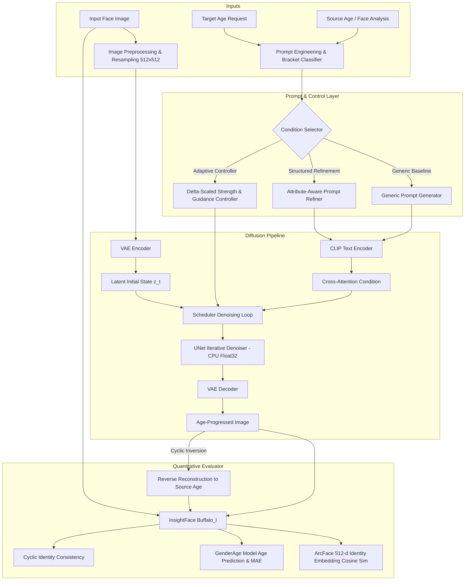

# AgeWeaver System Architecture

## 1. High-Level Architecture Overview

AgeWeaver is designed as an offline-first, memory-bounded, identity-preserving facial age progression framework optimized for execution on consumer hardware (16 GB RAM, CPU-only, Intel Iris Xe).

## 2. Core Subsystems

### 2.1 Configuration Layer (`ageweaver.config`)
- Strongly typed Python dataclasses: `PipelineConfig`, `PromptConfig`, `EvaluationConfig`, `AgeWeaverConfig`.
- Declarative YAML serialization (`configs/default.yaml`).
- Strict validation rules ensuring input image dimensions (multiples of 8), valid denoising strength ranges $[0.0, 1.0]$, and positive inference step limits.

### 2.2 Prompt Refinement Subsystem (`ageweaver.prompts`)
- **Generic Baseline**: Naive baseline mimicking naive text-conditioned generation (`"a portrait photo of a {age}-year-old person"`).
- **Face-Attribute-Aware Structured Refinement**:
  - Automatically identifies anatomical age brackets (adolescent, young adult, mature adult, middle-aged, senior, elderly).
  - Dynamically synthesizes localized skin texture markers (fine lines, nasolabial folds, crow's feet, wrinkles).
  - Injects hair maturation descriptors (silver highlights, graying temples, salt-and-pepper, silver-white).
  - Enforces invariant identity anchor tokens (`"maintaining identical facial bone structure, identical eye color, nose shape, and distinct personal facial geometry"`).
  - Applies a comprehensive negative prompt suppressing disfigurement, plastic oversmoothing, and demographic drift.

### 2.3 Inference Engine (`ageweaver.pipeline`)
- Wraps Diffusers `StableDiffusionImg2ImgPipeline` with local offline loading (`local_files_only=True`).
- Operates strictly in `torch.inference_mode()` on CPU float32 tensors with multi-threaded parallel execution.
- Implements the **Adaptive Denoising & Guidance Controller**:
  $$\Delta_{\text{age}} = |\text{target\_age} - \text{source\_age}|$$
  $$\sigma(\Delta) = \sigma_{\min} + (\sigma_{\max} - \sigma_{\min}) \cdot \min\left(1.0, \frac{\Delta}{50}\right)$$
  Adapts noise injection so that small age adjustments (e.g. 5–10 years) preserve fine identity contours, while large transformations (e.g. 40–50 years) introduce necessary structural maturation.

### 2.4 Identity & Metric Suite (`ageweaver.identity`, `ageweaver.evaluation`)
- Employs local InsightFace `buffalo_l` on ONNX Runtime CPU:
  - `det_10g.onnx`: Primary face localization and bounding box extraction.
  - `w600k_r50.onnx`: ResNet-50 ArcFace deep facial representation, producing a normalized 512-dimensional identity embedding vector $\mathbf{e} \in \mathbb{R}^{512}$.
  - `genderage.onnx`: Facial age estimation network for calculating Target-Age Mean Absolute Error:
    $$\text{MAE} = | \hat{y}_{\text{age}} - y_{\text{target}} |$$
  - `compute_cosine_similarity`:
    $$S_{\text{id}}(\mathbf{e}_1, \mathbf{e}_2) = \frac{\mathbf{e}_1 \cdot \mathbf{e}_2}{\|\mathbf{e}_1\|_2 \|\mathbf{e}_2\|_2}$$
  - **Cyclic Identity Similarity**: Full round-trip evaluation: $I_{\text{src}} \to I_{\text{progress}} \to I_{\text{recon}}$, comparing $\mathbf{e}_{\text{src}}$ against $\mathbf{e}_{\text{recon}}$.

### 2.5 Audit & Experiment Logging Subsystem (`ageweaver.experiment`)
- Produces atomic, reproducible records in both CSV and JSON Lines (`experiment_log.csv`, `experiment_log.jsonl`).
- Records SHA-256 hashes of input images, random seeds, wall-clock inference times, guidance scales, and exact textual prompts for full scientific auditability.

